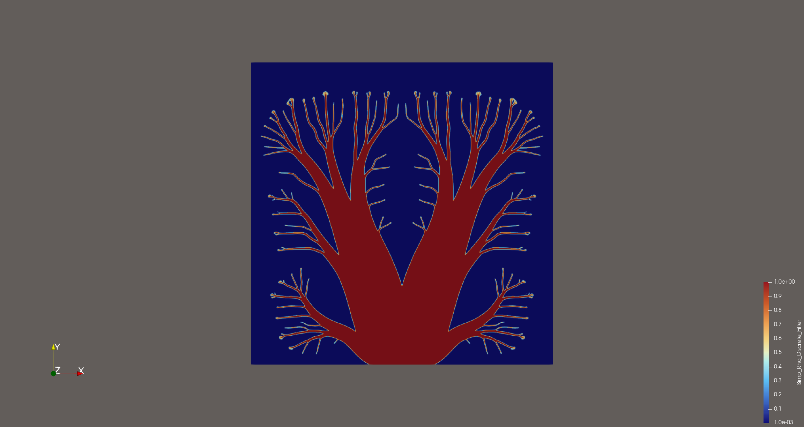
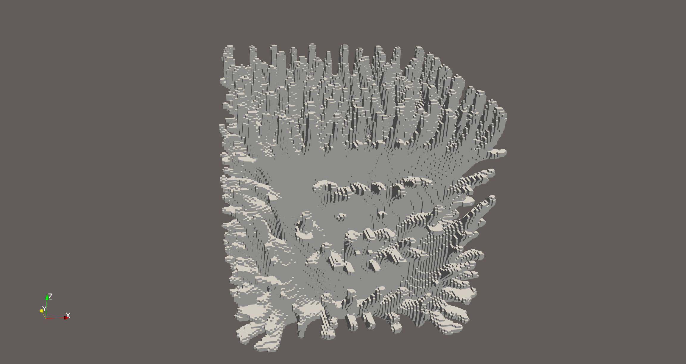
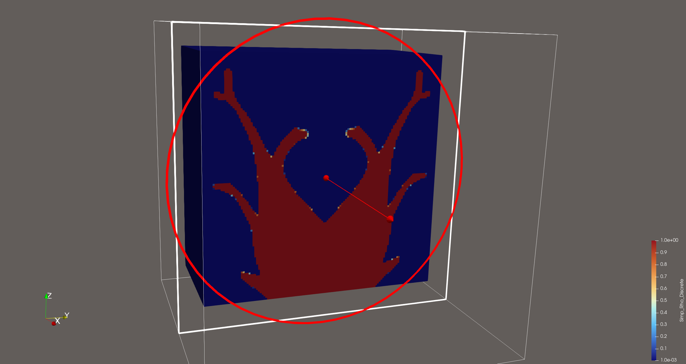

# Matrix-Free Topology Optimization with deal.II

A matrix-free, parallel finite-element implementation of density-based topology optimization for steady heat conduction in two and three dimensions. The code combines SIMP material interpolation, a Helmholtz-type PDE filter, geometric multigrid, Chebyshev smoothing, and the Method of Moving Asymptotes (MMA).

The main example minimizes thermal compliance subject to a volume-fraction constraint. The implementation is built around deal.II's `MatrixFree` and `FEEvaluation` interfaces: the state equation, density and sensitivity filters, and multigrid level operators are applied without assembling global sparse matrices.

The repository is based on ideas and implementation patterns from deal.II tutorials including step-15, step-33, step-37, step-40, and step-79.

## Motivation and design goals

The step-79 topology-optimization example provides a detailed introduction to SIMP interpolation, the optimization problem, and its solution strategy. The approach described there uses a logarithmic barrier formulation and a KKT system to handle constraints. For large-scale engineering problems, two aspects can become limiting:

- **KKT-system size.** Introducing auxiliary and dual variables can make the linearized system substantially larger than the design-variable system.
- **Explicit convolution filtering.** Constructing and storing a sparse neighborhood filter can become expensive as the mesh is refined or the filter radius is increased, particularly on unstructured meshes.
- **Large direct solves.** Direct solvers such as UMFPACK can require prohibitive memory and factorization time for large three-dimensional problems. Iterative solvers are more suitable, provided their preconditioners remain robust as the material contrast evolves during optimization.

This project therefore uses an MMA-based design update and a PDE-based filter, together with matrix-free operators and geometric multigrid. The motivation for the PDE filter, including its costs and limitations, is discussed in [PDE-based filtering](doc/extension/pde_filter.md).

## Problem formulation

The main example solves a two- or three-dimensional minimum-thermal-compliance problem on

@f[
\Omega=[-1,1]^d,\qquad d\in\{2,3\}.
@f]

The optimization problem is

@f[
\begin{aligned}
\min_{\rho,u}\quad & J(u,\rho),\\
\text{subject to}\quad & g(\rho)\leq 0,\\
& \mathbf R(u,\rho)=\mathbf 0.
\end{aligned}
@f]

Here, $u$ is the physical state field (temperature in the main example), and $\rho$ is the design variable used by the SIMP model. Depending on the application, the state field could instead represent displacement, electric potential, velocity, pressure, or another physical quantity. The objective $J$ and the constraint $g$ are problem-dependent.

### Steady heat-conduction problem

The state equation is

@f[
\begin{aligned}
-\nabla\cdot\bigl(k(\rho)\nabla u\bigr)&=f &&\text{in }\Omega,\\
u&=0 &&\text{on }\Gamma_D,\\
k(\rho)\nabla u\cdot n&=0 &&\text{on }\partial\Omega\setminus\Gamma_D,
\end{aligned}
@f]

where the heat source is $f=10$. The Dirichlet boundary $\Gamma_D$ is a small patch centered on the bottom boundary of the design domain and is assigned boundary id `1`. The remaining boundary has a homogeneous Neumann condition.

### SIMP interpolation

The conductivity is interpolated from the design variable by

@f[
k(\rho)=k_{\mathrm{solid}}\left[\varepsilon_{\min}+(1-\varepsilon_{\min})\rho^p\right],
@f]

with

@f[
k_{\mathrm{solid}}=10,\qquad \varepsilon_{\min}=10^{-2},\qquad p=3.
@f]

The design variable satisfies $0\leq\rho\leq1$. It is stored as an `FE_DGQ(0)` field, with one degree of freedom per cell. The filtered density is represented in a continuous `Q1` space.

### Objective and volume constraint

The objective is the self-adjoint thermal compliance

@f[
J(u,\rho)=\int_\Omega k(\rho)|\nabla u|^2\,\mathrm dx.
@f]

For the stated state equation and homogeneous Dirichlet data, this is also equal to $b^T u$, where $b$ is the discrete heat-load vector.

The volume-fraction constraint is

@f[
g(\rho)=
\frac{\displaystyle\sum_K\rho_K|K|}
{\displaystyle v_f\sum_K|K|}-1\leq0,
\qquad v_f=0.3.
@f]

### Density filtering

The raw design density is mapped to a filtered density $\widetilde\rho$ by solving the Helmholtz-type equation

@f[
\left(1-R_{\min}^2\Delta\right)\widetilde\rho=\rho,
@f]

with a homogeneous Neumann boundary condition. In this implementation, the filter radius is selected from the mesh size as

@f[
R_{\min}=\frac{h}{2\sqrt{3}},\qquad
h=\left(\max_K|K|\right)^{1/d}.
@f]

The same Helmholtz operator is reused to smooth the objective sensitivities; only the right-hand side is changed. For an exact discrete derivative through a density-filter map, the transpose filter operator and the corresponding discrete mass-matrix mapping must be consistent with the chosen density and filtered-density spaces. Further discussion is provided in [PDE-based filtering](doc/extension/pde_filter.md).

## Numerical methods

| Component | Discretization / solver |
|---|---|
| Temperature $u$ | Continuous `Q1` finite elements; matrix-free `FEEvaluation` operator |
| Filtered density $\widetilde\rho$ | Continuous `Q1` finite elements; matrix-free Helmholtz operator |
| Design density $\rho$ | `FE_DGQ(0)`, one degree of freedom per cell |
| State equation | BiCGStab with geometric multigrid preconditioning and Chebyshev smoothing |
| Density and sensitivity filter | FGMRES with geometric multigrid preconditioning and Chebyshev smoothing |
| Multigrid level operators | Single precision (`float`); finest-level operator uses double precision |
| Design update | MMA |

### Matrix-free implementation

The main linear operators are implemented with deal.II's `MatrixFree`, `FEEvaluation`, and `MatrixFreeOperators::Base` interfaces. No global sparse matrix is assembled for the state equation or the Helmholtz filter. The multigrid level operators are matrix-free as well.

The implementation uses:

- deal.II matrix-free operator interfaces (`MatrixFree` and `FEEvaluation`);
- geometric multigrid built from matrix-free level operators;
- a Helmholtz-type PDE filter for the design density and sensitivity smoothing;
- SIMP material interpolation;
- MMA for the design-variable update;
- MPI-distributed meshes and vectors, with SIMD vectorization through `VectorizedArray`.

The PDE filter avoids explicit geometric-neighborhood searches and the storage of a nonlocal convolution matrix. Its practical advantages and the assumptions behind its scalability are described in [PDE-based filtering](doc/extension/pde_filter.md).

### Operator reuse

All mesh-dependent structures are set up before the optimization loop. These include the `MatrixFree<dim, double>` objects, multigrid level operators, intergrid transfer operators, and multigrid hierarchies.

Within each MMA iteration, the code refreshes the cell-wise SIMP conductivity through `evaluate_coefficient()` and updates the inverse diagonal through `compute_diagonal()`. The state-equation and filter right-hand sides are assembled as needed. Density filtering and sensitivity filtering reuse the same Helmholtz operator and differ only in their right-hand sides.

## Implementation structure

```text
HEAT_MF_OPT/
├── CMakeLists.txt
├── doc
│   ├── author
│   ├── build-on
│   ├── dependencies
│   ├── entry-name
│   ├── extension
│   │   ├── adaptive_mesh.md
│   │   ├── automatic_differentiation.md
│   │   ├── elasticity.md
│   │   ├── Elasticity_Solver
│   │   │   ├── include
│   │   │   │   ├── Deal_II_MMA.h
│   │   │   │   └── Elasticity_Matrix_Free.h
│   │   │   └── src
│   │   │       ├── Filter_Solver.cpp
│   │   │       ├── main.cpp
│   │   │       ├── Mutilgrid_Solver.cpp
│   │   │       └── Topology_Loop.cpp
│   │   └── pde_filter.md
│   └── tooltip
├── fig
│   ├── force-1.png
│   ├── heat-1.png
│   ├── heat-2.png
│   ├── heat-3.png
│   └── heat-4.png
├── include
│   ├── Deal_II_MMA.h
│   └── Heat_Matrix_Free.h
├── README.md
└── src
    ├── Filter_Solver.cpp
    ├── main.cpp
    ├── Mutilgrid_Solver.cpp
    └── Topology_Loop.cpp
```

The main classes are:

| Class | Responsibility |
|---|---|
| `Laplace_Matrix_Free` | Matrix-free operator for $-\nabla\cdot(k(\rho)\nabla u)$, including the SIMP coefficient |
| `Helmholtz_Matrix_Free` | Matrix-free operator for the Helmholtz filter $1-R_{\min}^2\Delta$ |
| `Heat_Solver` | Driver class for mesh and DoF management, multigrid setup, and the optimization loop |

### Optimization loop

The main workflow is:

```text
make_grid
setup_simp_system / get_cell_volume
setup_laplace_system
setup_multigrid_laplace_system
setup_filter_system
setup_multigrid_filter_system

MMA optimization loop:
    density filtering       (assemble_filter_rhs + solve_filter_chebyshev)
    projection to DGQ(0)   (generate_average_vector)
    SIMP coefficient update (interpolate_simp_vector)
    state solve             (assemble_laplace_rhs + solve_chebyshev)
    sensitivity evaluation  (generate_object_discrete_derivative)
    sensitivity filtering   (assemble_filter_rhs + solve_filter_chebyshev)
    MMA design update
    write VTU output every 10 iterations
```

## Parallelism and vectorization

- Distributed meshes are provided by `parallel::distributed::Triangulation` (MPI / p4est).
- Matrix-free kernels use `VectorizedArray` for SIMD vectorization (AVX2 or AVX-512, depending on the deal.II build configuration).
- Multigrid level operators and vectors use single precision; the finest-level operator uses double precision.

## Build and run

### Dependencies

- deal.II 9.5 or newer; the project has been tested with deal.II 9.8.
- deal.II must be configured with `DEAL_II_WITH_MPI=ON` and `DEAL_II_WITH_P4EST=ON`.
- CMake 3.17 or newer.
- The MMA header `Deal_II_MMA.h` is included in `include/`; it is not part of deal.II itself.

### Build

```bash
cmake -DDEAL_II_DIR=/path/to/dealii .
make
```

### Run

The default executable runs the two- and three-dimensional examples using `Heat_Solver<2, 1>` and `Heat_Solver<3, 1>`.

```bash
make run
```

To run with four MPI ranks:

```bash
mpirun -np 4 ./topology_optimization
```

To use a different finite-element degree, update the explicit instantiations at the end of `include/Heat_Matrix_Free.h` and the corresponding instantiations in `src/main.cpp`. The implementation is split across headers and source files rather than placing the complete program in a single header.

## Output

Every ten MMA iterations, the program writes a PVTU file to the working directory:

```text
Simp_Optimization_<iter>.pvtu
```

with one VTU piece per MPI rank. The output includes:

- `Simp_Rho_Discrete` — current design density;
- `Simp_Rho_Discrete_Filter` — filtered design density;
- `Cell_Volume_Discrete` — cell volume;
- `Object_Discrete_Derivative` — filtered objective sensitivity;
- `Constraint_Discrete_Derivative` — volume-constraint sensitivity.

The console reports the objective value, design change, current volume fraction, and iteration counts for the state and filter linear solvers at each optimization iteration.

## Results and performance

The following timings were measured on a personal computer with an Intel Core i5-13500H (13th generation) processor and 32 GB of RAM. Each run used four MPI ranks. They are measurements for this particular hardware and software configuration, not performance guarantees for other systems.

### Two-dimensional examples

| Active cells | MMA iterations | Total time |
|---:|---:|---:|
| 4,096 | 50 | 0.9 s |
| 16,384 | 52 | 2.5 s |
| 65,536 | 71 | 12.5 s |
| 262,144 | 79 | 59.4 s |
| 1,048,576 | 90 | 297 s |

### Three-dimensional examples

| Active cells | MMA iterations | Total time |
|---:|---:|---:|
| 32,768 | 40 | 3.8 s |
| 262,144 | 59 | 34 s |
| 2,097,152 | 53 | 309 s |
| 16,777,216 | 70 | 2,770 s |

For the tested configuration, the state-equation BiCGStab iteration count increased from approximately 4 in the early optimization iterations to approximately 9 in the later iterations. This indicates that the chosen geometric multigrid preconditioner remained effective for these runs as the material distribution evolved. It should not be interpreted as a mesh-independent or contrast-independent guarantee for arbitrary problems.

The expected two-dimensional design is a branching, tree-like high-conductivity network connecting the distributed heat source to the heat sink near the center of the bottom boundary. The three-dimensional example produces a corresponding three-dimensional conducting network. The output images in the repository illustrate the optimized structures and representative cross-sections:

**Two-dimensional result**



**Three-dimensional result**





The optimization history and final design depend on the mesh, filter radius, MMA settings, and stopping criterion. The objective and design-change histories should therefore be inspected together rather than assuming that the objective decreases monotonically at every iteration.

## Extensions

The following documents describe extensions beyond the main scalar heat-conduction example:

- [PDE-based density and sensitivity filtering](doc/extension/pde_filter.md) — motivation, weak form, computational scaling, and implementation considerations.
- [Vector-valued elasticity topology optimization](doc/extension/elasticity.md) — changing the scalar diffusion operator to a linear-elasticity operator.
- [Adaptive mesh refinement](doc/extension/adaptive_mesh.md) — transferring design and MMA history vectors across mesh changes.
- [Automatic differentiation for adjoint sensitivities](doc/extension/automatic_differentiation.md) — residual linearization and an illustrative nonlinear scalar PDE example.

## References

1. Svanberg, K. (1987). “The method of moving asymptotes—a new method for structural optimization.” *International Journal for Numerical Methods in Engineering*.
2. Svanberg, K. (2002). “A class of globally convergent optimization methods based on conservative convex separable approximations.” *SIAM Journal on Optimization*.
3. Bendsøe, M. P., and Sigmund, O. (2003). *Topology Optimization: Theory, Methods, and Applications*. Springer.
4. Borrvall, T., and Petersson, J. (2003). “Topology optimization of fluids in Stokes flow.” *International Journal for Numerical Methods in Fluids*.
5. Sigmund, O., and Maute, K. (2013). “Topology optimization approaches.” *Structural and Multidisciplinary Optimization*.
6. Kollmannsberger, S., et al. (2019). *Parameter-free, Matrix-free Finite Element Methods*. Wiley.
7. [deal.II documentation](https://www.dealii.org/).
8. [TopOpt in PETSc](https://github.com/topopt/TopOpt_in_PETSc) — source of the MMA implementation adapted for deal.II.
9. Aage, N., et al. (2015). “Topology optimization using PETSc: An easy-to-use, fully parallel, open source topology optimization framework.” *Structural and Multidisciplinary Optimization*, 51(3), 565–572. [https://doi.org/10.1007/s00158-014-1157-0](https://doi.org/10.1007/s00158-014-1157-0).

## License

This code is distributed under the GNU Lesser General Public License (LGPL), version 2.1 or later.

## Contact

- **Author:** XiangLei Zeng
- **Email:** xiangleiceng737@gmail.com
