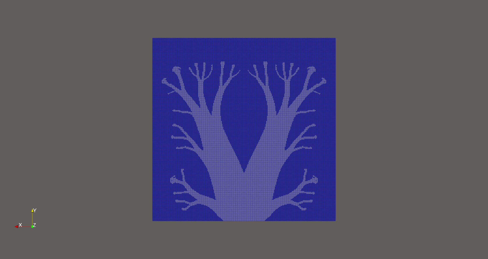

# Extension: Adaptive Mesh Refinement

Adaptive mesh refinement can reduce the cost of topology optimization by concentrating degrees of freedom in regions where additional spatial resolution is useful. When the mesh changes, the design field and the MMA history vectors must be transferred to the new mesh. The mesh-dependent state and filter operators, multigrid hierarchies, and cell-volume data must also be rebuilt.

## Vectors to transfer

In the implementation, the following vectors are transferred across refinement and coarsening:

- the current design density `Simp_Rho_Discrete`;
- the MMA moving lower and upper bounds;
- the two previous design iterates stored in `MMA_Optimizer.Old_Design_Variables`;
- the maximum and minimum design-variable bounds, `Simp_Rho_Discrete_Max` and `Simp_Rho_Discrete_Min`.

The transfer is performed with `SolutionTransfer` associated with the design-variable DoFHandler.

## Refinement procedure

The main sequence is:

1. Estimate the refinement indicator and mark cells for refinement or coarsening.
2. Prepare the vectors for transfer.
3. Execute mesh adaptation.
4. Reinitialize the design DoFHandler and the MMA data structures.
5. Interpolate the transferred vectors onto the new mesh.
6. Rebuild all mesh-dependent state, filter, and multigrid data structures.
7. Recompute cell volumes.

A representative implementation is:

```cpp
void Refine_Grid()
{
  TimerOutput::Scope t(computing_timer, "Refine_Grid");

  // Compute an error indicator and mark cells for refinement/coarsening.
  // ...

  const std::vector<const VectorType *> vectors_in = {
    &Simp_Rho_Discrete,
    &MMA_Optimizer.Moving_Low_Boundary,
    &MMA_Optimizer.Moving_Upp_Boundary,
    &MMA_Optimizer.Old_Design_Variables[0],
    &MMA_Optimizer.Old_Design_Variables[1],
    &Simp_Rho_Discrete_Max,
    &Simp_Rho_Discrete_Min};

  SolutionTransfer<dim, VectorType>
    solution_transfer(dof_handler_simp);

  triangulation.prepare_coarsening_and_refinement();
  solution_transfer.prepare_for_coarsening_and_refinement(vectors_in);
  triangulation.execute_coarsening_and_refinement();

  // Rebuild the design DoFHandler and reinitialize the MMA vectors.
  setup_simp_system();
  MMA_Optimizer.Deal_II_MMA_Reinit(Simp_Rho_Discrete);
  get_cell_volume();
  Rmin = 2. * pow(Cell_Volume_Discrete.linfty_norm(), 1./(double)dim) / (2. * sqrt(3.));

  std::vector<VectorType *> vectors_out = {
    &Simp_Rho_Discrete,
    &MMA_Optimizer.Moving_Low_Boundary,
    &MMA_Optimizer.Moving_Upp_Boundary,
    &MMA_Optimizer.Old_Design_Variables[0],
    &MMA_Optimizer.Old_Design_Variables[1],
    &Simp_Rho_Discrete_Max,
    &Simp_Rho_Discrete_Min};

  solution_transfer.interpolate(vectors_out);

  // Rebuild all mesh-dependent operators and multigrid hierarchies.
  setup_laplace_system();
  setup_multigrid_laplace_system();
  setup_filter_system();
  setup_multigrid_filter_system();

  // Print Freedom
  pcout<<std::endl;
  pcout<<"+---------------------------------------------------------------------------+"<<std::endl;
  pcout<<"|                           REFINE GRID FREEDOM                             |"<<std::endl;
  pcout<<"+---------------------------------------------------------------------------+"<<std::endl;
  pcout<<std::endl;

  pcout<<"+---------------------------------------------------------------------------+"<<std::endl;
  pcout<<"                             "<< "Simp    : "<< dof_handler_simp.n_dofs() << std::endl;
  pcout<<"                             "<< "Laplace : "<< dof_handler.n_dofs() << std::endl;
  pcout<<"                             "<< "Filter  : "<< dof_handler_filter.n_dofs() << std::endl;
  pcout<<"+---------------------------------------------------------------------------+"<<std::endl;
  pcout<<std::endl;
}
// In topology optimization loop
if(MMA_Optimizer.Loop_Iter % 30 == 0)
{
  Refine_Grid();
  //
  assemble_filter_rhs(Cell_Volume_Discrete);
  solve_filter_chebyshev();
  generate_average_vector(Constraint_Discrete_Derivative[0]);
  Constraint_Discrete_Derivative[0] /=  (volfrac * Cell_Volume_Discrete.l1_norm());
}
```

Optimization Mesh look like


## Practical considerations

The transferred MMA history should remain consistent with the transferred design variables and their bounds. After adaptation, verify that the design values remain within their admissible interval and that the global volume constraint is evaluated using the new cell volumes. The state solution may also be transferred as an initial guess if desired, but its transfer is separate from the design/MMA data shown above.

The adaptive-mesh example is supplementary to the globally refined main benchmark. Its results depend on the chosen error estimator, refinement strategy, and transfer policy.
